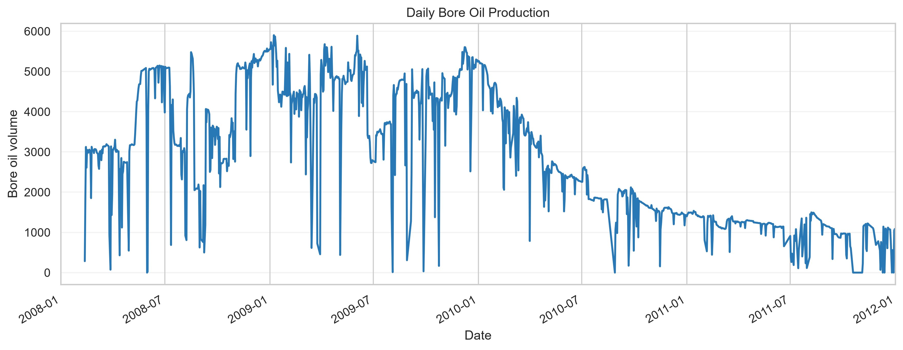
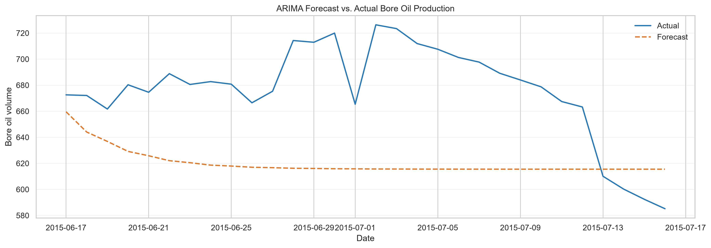
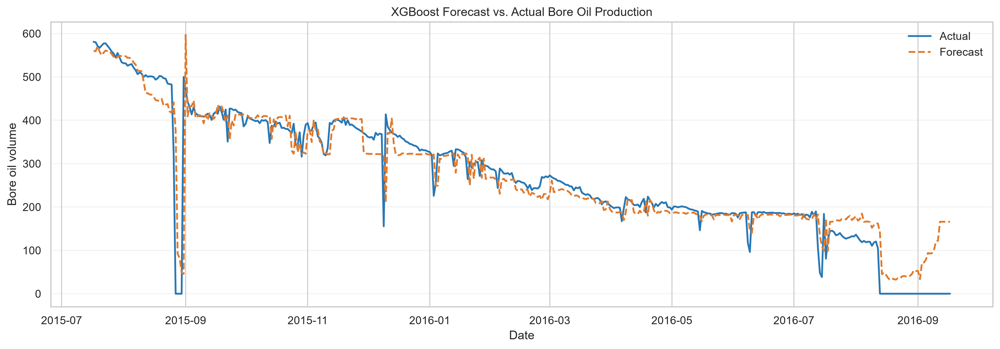
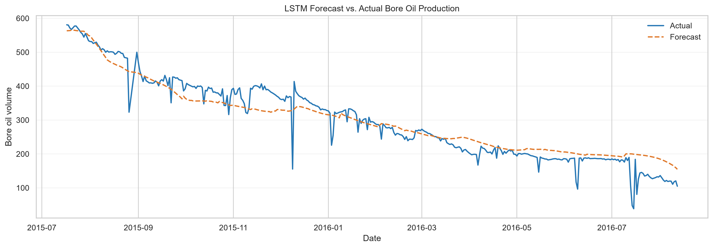

# Volve Bore Oil Production Forecasting

A time-series forecasting project for daily bore oil production from the Volve field. The notebook explores the data and compares ARIMA, XGBoost, and LSTM approaches. Reusable data, feature, modeling, evaluation, and plotting functions live in `src/`.

## Project structure

```text
.
├── data/
│   └── Volve production data.xlsx
├── figures/                   # Generated forecast and diagnostic plots
├── models/                    # Serialized fitted models
├── notebooks/
│   └── time_series.ipynb      # Exploration, diagnostics, and model comparison
├── src/
│   ├── data/                  # Workbook loading and data preparation
│   ├── evaluation/            # Regression metrics
│   ├── features/              # Lag feature creation
│   ├── modeling/              # ARIMA, XGBoost, and LSTM
│   ├── visualization/         # Forecast plot helpers
│   ├── utils/                 # Artifact saving
│   └── run_pipeline.py        # End-to-end training entry point
└── requirements.txt
```

## Setup

Use Python 3.10 or later. From the project root, install the dependencies:

```bash
python -m venv .venv
```

Activate the environment, then run:

```bash
python -m pip install -r requirements.txt
```

The pipeline expects `data/Volve production data.xlsx`. The workbook must include a `Daily Production Data` sheet with `DATEPRD`, `NPD_WELL_BORE_NAME`, `FLOW_KIND`, and `BORE_OIL_VOL` columns, along with the numeric fields used during preparation.

## Run the forecasting pipeline

From the project root:

```bash
python -m src.run_pipeline
```

The pipeline selects production-only records for well `15/9-F-12`, sorts them by date, and reserves the latest 15% of records as the test partition. It removes non-positive oil-volume rows and the `BORE_WI_VOL` field, then fits a median imputer on the training partition and applies it to the test partition.

The default run saves model artifacts in `models/` and forecast comparison plots in `figures/`. The returned and printed metrics are MAE, RMSE, and R².

### Models

- **ARIMA:** fits ARIMA(3, 1, 2) on the training oil-volume series and forecasts up to the next 30 daily observations.
- **XGBoost:** uses the previous 30 observed oil-volume values as lag features. The estimator uses 500 trees, learning rate 0.05, and maximum depth 4.
- **LSTM:** receives the same 30 lag values as a one-feature sequence. Input and target scalers are fitted on training data; validation loss controls early stopping.

## Evaluation notes

The lag-based XGBoost and LSTM test features use actual observations from earlier dates in the test period. Their scores therefore describe **rolling one-step-ahead forecasts**, where the latest actual value is available before predicting the next date. ARIMA forecasts a fixed horizon from the end of training. These evaluation protocols differ, so compare the metrics with that distinction in mind.

The train and validation date windows for XGBoost and LSTM are currently specified in `src/run_pipeline.py` to match the notebook. If the dataset’s date coverage changes, update those windows before running the pipeline.

## Figures

The production history below shows the decline and day-to-day variation in the selected well's oil volume.



The forecast plots compare actual production with each model's predictions on its test window. XGBoost and LSTM use rolling one-step-ahead predictions, while ARIMA forecasts a fixed horizon from the end of the training period.

### ARIMA



### XGBoost



### LSTM



## Notebook

Open `notebooks/time_series.ipynb` for the documented exploratory workflow, time-series diagnostics, visualizations, and model cells. Run it from top to bottom because later cells depend on dataframes and fitted objects created earlier. The workbook path near the beginning of the notebook may need to be adjusted for your machine.

## Source modules

See [`src/README.md`](src/README.md) for a module-by-module guide and run instructions. The `run_pipeline` function in `src/run_pipeline.py` also accepts custom workbook, model-output, and figure-output paths.
