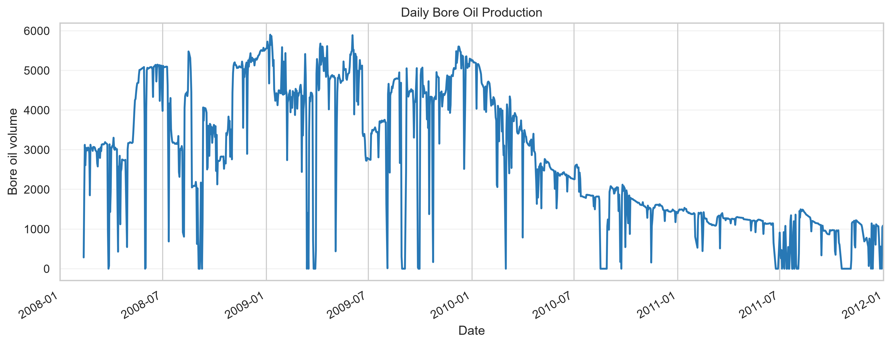
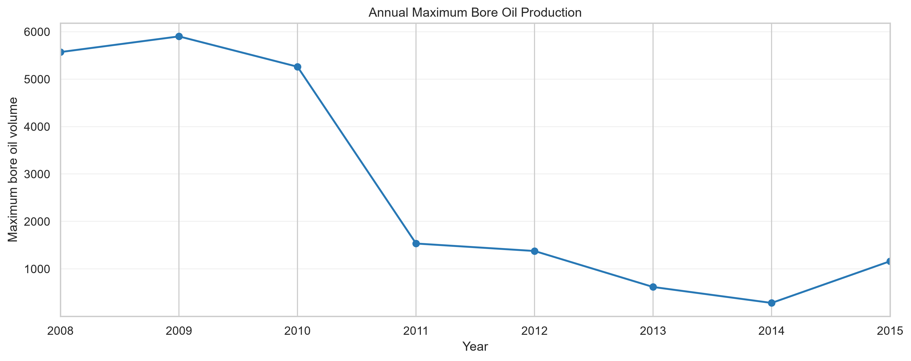
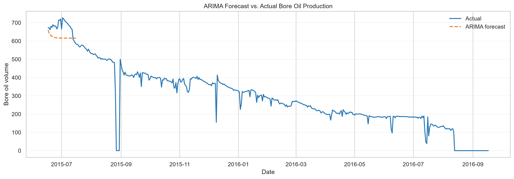
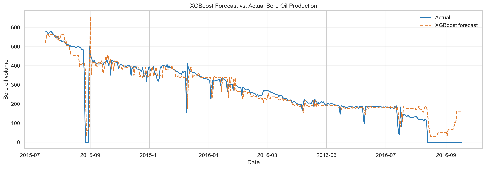
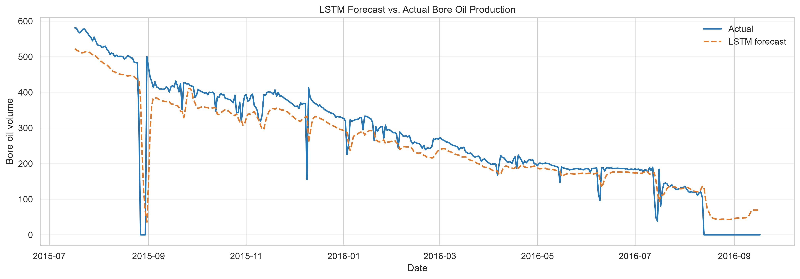
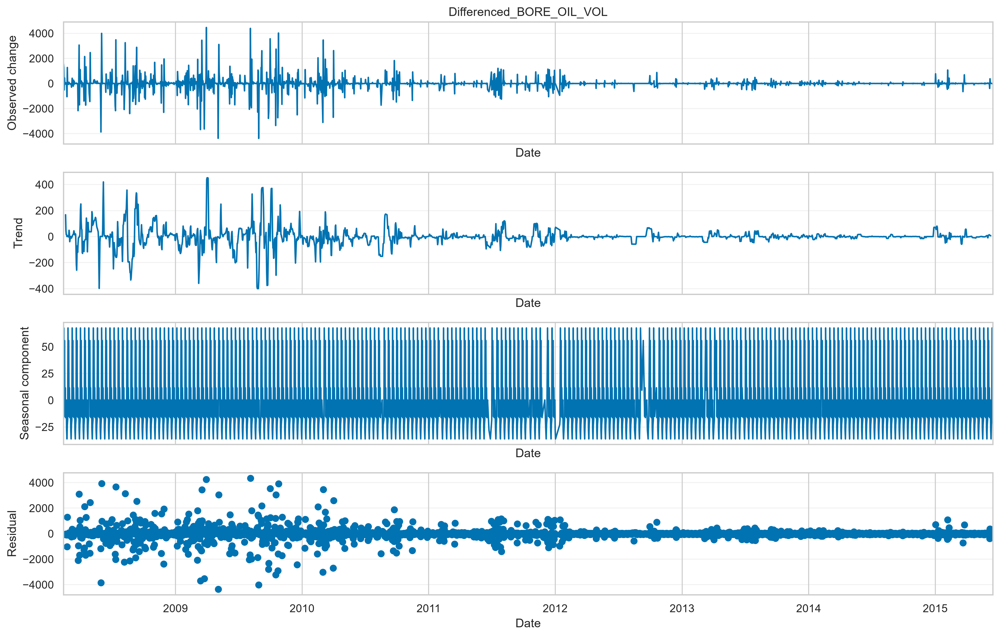

# Volve Oil Production Forecasting

Forecast daily bore oil production for Volve well `15/9-F-12` using statistical and machine-learning models. The project combines exploratory time-series analysis with a reusable Python pipeline for data preparation, training, evaluation, and plotting.

## Project overview

The workflow reads the included production workbook, selects production-only records for the target well, sorts them by date, and creates a chronological 85/15 train/test split. It removes non-positive oil-volume records and the unused water-injection feature, then imputes numeric gaps using medians learned from the training data.

Three approaches are explored:

- **ARIMA (3, 1, 2):** produces a 30-day forecast from the training series.
- **XGBoost:** predicts production from the previous 30 observations.
- **LSTM:** treats the same 30 observations as a sequence and uses validation-based early stopping.

The notebook contains the exploration and experiments. The root-level `run_pipeline.py` provides the reusable end-to-end workflow.

## Results

The saved notebook reports the following test results. XGBoost and LSTM use rolling one-step-ahead predictions: each forecast can use observed values from earlier test dates. ARIMA is evaluated over a fixed 30-day horizon, so its results should not be compared directly with the full-period lag-model scores.

| Notebook experiment | Test RMSE | Test R² | Notes |
| --- | ---: | ---: | --- |
| XGBoost, fixed settings | 52.87 | 0.864 | 500 trees, depth 6, learning rate 0.05 |
| XGBoost, Optuna-tuned | 50.14 | 0.88 | Tuned on the validation window |
| LSTM | 53.70 | 0.860 | 30 lags, 64 LSTM units |

These are values from the notebook's saved outputs, not a fresh run of the pipeline. The pipeline's default XGBoost depth is 4; the notebook's fixed experiment uses depth 6. The ARIMA forecast is plotted in the notebook, but a test RMSE/R² value is not reported there.

## Figures

### Production history

Daily bore oil production for the selected well.



### Yearly bore oil production

Yearly maximum bore oil production for the selected well. The chart shows the decline in peak production after 2010.



### Forecast comparisons

The plots compare each model's predictions with observed production. ARIMA shows a fixed 30-day forecast; XGBoost and LSTM show rolling test predictions.

**ARIMA**



**XGBoost**



**LSTM**



### Time-series diagnostics

Seasonal decomposition illustrates the observed trend and seasonal component used during exploration.



## Quick start

Requires Python 3.10 or later. From the repository root:

```bash
python -m venv .venv
```

Activate the environment, then install dependencies and run the pipeline:

```bash
python -m pip install -r requirements.txt
python run_pipeline.py
```

The pipeline expects `data/Volve production data.xlsx`, with a `Daily Production Data` sheet containing `DATEPRD`, `NPD_WELL_BORE_NAME`, `FLOW_KIND`, and `BORE_OIL_VOL`. Numeric production fields used during preparation should also be present. To run the exploratory analysis, open `notebooks/time_series.ipynb` and execute cells from top to bottom; update its workbook path for your machine.

## Repository structure

| Path | Contents |
| --- | --- |
| `data/` | Source Volve production workbook. |
| `notebooks/` | Exploratory analysis, diagnostics, model experiments, and notebook-specific figures/artifacts. |
| `figures/` | Saved production, diagnostic, and forecast plots from the project workflow. |
| `models/` | Serialized model artifact currently included in the repository. |
| `src/data/` | Workbook loading, well selection, cleaning, and imputation. |
| `src/features/` | Lag-feature generation. |
| `src/modeling/` | ARIMA, XGBoost, and LSTM training code. |
| `src/evaluation/` | MAE, RMSE, and R² calculations. |
| `src/visualization/` | Forecast plot creation. |
| `src/utils/` | Model artifact serialization. |
| `run_pipeline.py` | End-to-end training and evaluation entry point. |
| `requirements.txt` | Python package dependencies. |

## Evaluation and reproducibility

The pipeline reports **MAE**, **RMSE**, and **R²**. XGBoost and LSTM use 30-day lag features and date windows configured in `run_pipeline.py`; update those windows if the workbook's date coverage changes. The pipeline saves model artifacts to `models/` and forecast plots to `figures/`. The `run_pipeline()` function accepts custom workbook, model-output, and figure-output paths.

The repository includes the workbook and saved figures for inspection. Model files are serialized Python artifacts and may depend on compatible versions of the libraries listed in `requirements.txt`.

## License

See [LICENSE](LICENSE).
